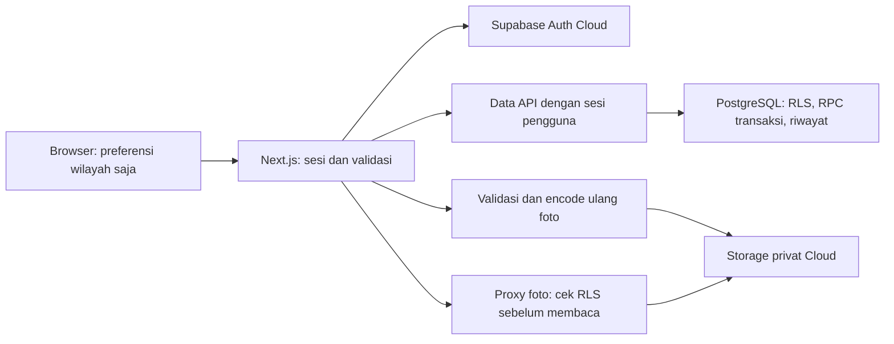

# Arsitektur dan keputusan

## Aliran data

TypeScript + Next.js App Router 16.4, React, Supabase JS/SSR, Zod, Sharp, dan Leaflet. CSS biasa menjaga dependensi tampilan kecil dan memakai palet PRD. Lockfile menyimpan versi konkret. Backend Cloud memungkinkan kedua laptop memakai data yang sama tanpa Docker. Pilihan ini mengikuti instruksi pengguna setelah pemeriksaan awal menemukan mesin Docker gagal mulai.

Server memverifikasi pengguna melalui Auth `getUser`; cookie sesi HttpOnly/SameSite dan tidak disimpan pada localStorage. Semua operasi data memakai publishable key **bersama sesi pengguna**, sehingga izin basis data tetap berlaku. Kunci server hanya dipakai pada proxy Storage, unggahan tervalidasi, dan skrip persiapan/backup. Modul server ditandai `server-only`.

## Entitas dan izin

Wilayah, profil/keanggotaan, titik, insiden, laporan pendukung, tugas, feedback, jadwal/pengecualian/aktual, pencegahan, kegiatan/peserta, foto, riwayat, pemberitahuan, dan receipt idempotensi merupakan entitas terpisah. Dua laporan pada satu insiden tidak menjadi dua pekerjaan. Bukti terkait laporan/tugas/kegiatan dengan kepemilikan dan ID yang nyata.

Semua tabel memiliki RLS. API anon/authenticated hanya mempunyai hak SELECT yang dibatasi kebijakan; perubahan langsung ke tabel ditolak. RPC `command` memvalidasi peran dan cakupan setiap tindakan. Helper internal yang bisa menulis dicabut hak EXECUTE-nya dari API roles. Signup hanya membuat profil pelapor, tidak membaca hak admin/koordinator dari metadata.

`public_region_data` merupakan proyeksi aman: tanpa identitas pelapor, kontak, foto privat, atau koordinat tepat titik. Pengunjung boleh melihat jadwal belum dikonfirmasi dengan label eksplisit. Koordinator membaca data privat hanya di cakupan wilayahnya; petugas membaca tugas dan insiden yang pernah ditugaskan kepadanya selama keanggotaannya aktif; pelapor membaca laporan sendiri dan perkembangan insidennya.

## Integritas

- Receipt memakai `(actor, request_key)` dan payload; pengulangan payload yang sama mengembalikan hasil yang sama. Key dengan payload lain ditolak.
- Row lock + version mencegah transisi dari snapshot basi. Urutan lock insiden sebelum tugas dipertahankan. Penugasan ulang menandai tugas lama sebagai superseded.
- Satu insiden terbuka per titik dan satu tugas aktif per insiden dijaga indeks unik. Koordinator memutuskan duplikat; koordinat tidak otomatis menentukan kesamaan.
- Kejadian baru pada titik lama harus diamati sesudah penutupan sebelumnya. Pembukaan kembali memakai ID lama. Penghitungan titik memakai ID insiden berbeda dan waktu validasi, bukan jumlah laporan/foto.
- Baris kegiatan dikunci sebelum menghitung kapasitas; pasangan kegiatan/akun unik. Pendaftaran ganda mengembalikan keadaan sudah terdaftar tanpa kursi tambahan.
- Foto diterima hanya melalui route server, dibatasi 1–3 dan 5 MB, didekode Sharp (limit 25 juta piksel), diverifikasi sesuai MIME, lalu diubah ke JPEG maksimal 1920 px. Metadata EXIF/GPS dibuang. Storage client tidak mempunyai INSERT policy.
- CSV mengutip sel dan menetralkan awalan formula termasuk whitespace/control prefix. Ekspor memeriksa hak koordinator wilayah pada server.

Permintaan dibatasi ukurannya termasuk stream tanpa Content-Length. Origin mutation harus sama dengan APP_ORIGIN. API privat tidak dicache. Foto memakai proxy berizin dengan cache `private, no-store`; optimisasi gambar publik tidak dipakai untuk foto privat.

Ruang kerja/CSV dibatasi 1000 baris per entitas/periode untuk pilot kecil. Bila lebih, server menolak menghasilkan angka yang terpotong dan meminta cakupan lebih kecil. Realtime, arsip berskala besar, dan layanan pemberitahuan eksternal berada di luar tahap ini.

## Desain dan batas keputusan

Hijau `#166534` menyatakan kepedulian dan tanggung jawab dalam identitas produk; teal `#0F766E` menyatakan kolaborasi. Latar `#F8FAFC`, permukaan putih, teks `#0F172A`/`#475569`. Label informasi, perhatian, kesalahan, dan selesai mengikuti pasangan PRD. Makna itu merupakan keputusan identitas, bukan psikologi universal.

Font sistem, dasar 16 px, tombol utama 44 px, fokus biru yang terlihat, label/ikon status selain warna, kesalahan kolom, keadaan kosong/loading/gagal/berhasil, serta daftar/patokan saat peta gagal disediakan. Tile OSM hanya dimuat sesuai viewport dan atribusi tetap ditampilkan; tidak ada prefetch atau unduhan offline. Koordinat pusat wilayah simulasi bukan bukti batas geografis pilot.

Usulan untuk dibahas tanpa mengubah PRD: batas 1000 baris sementara; feedback tanpa tenggat otomatis sampai kebijakan pilot ditetapkan; satu insiden terkait per kegiatan untuk tahap sederhana (skema memungkinkan perluasan relasi kemudian); waktu aplikasi tampil WIB; refresh manual lintas laptop; kebijakan masa simpan belum ditetapkan. Kegiatan belum mempunyai editor umum setelah terbit; draf dapat melengkapi pengangkutan, dan perubahan operasional besar dibuat sebagai rencana baru.
